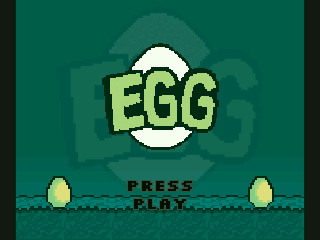

   EGG  -  for the TI-84 Plus CE
==============================================================
An almost accurate 1:1 recreation of the secret scanner game called EGG in ROBLOX doors.
It saves the progress of your current round if you accidentally exit the game.

It includes pretty much every feature the original has to offer:
- Functional Leaderboard
- Infinite Mode after 3 rounds
- Hidden Cheater Screen
- Charles Jumpscare

I hope you, the player, have fun playing the game on your calculator as it was one hell of a work
sourcing out all of the original assets and then converting all the luau code into C.

It's safe to say I will NOT be open-sourcing this project due to how much effort that went into this.
This is also my first-ever calculator game.

Gameplay of EGG on a calculator is in the following video (https://www.youtube.com/watch?v=9lXlxsfaI9c).
May be a little outdated.

*v1.0 - Port by epic-ali*

--------------------------------------------------------------
Requirements
--------------------------------------------------------------
- TI-84 Plus CE (tested on real hardware)
- About 55 KB free archive memory
- The CE C libraries (clibs.8xg). Get the latest from
  https://github.com/CE-Programming/libraries/releases
- OS 5.5 or newer: you need arTIfiCE to run assembly/C programs
  (https://yvantt.github.io/arTIfiCE/). On OS 5.4 or older,
  Asm(prgmEGG) works directly.

--------------------------------------------------------------
Usage
--------------------------------------------------------------
1. Send clibs.8xg to the calculator (skip this if you already
   have it).
2. Send EGG.8xp with TI Connect CE.
   Put it inside Archive or RAM, your choice.
3. Run EGG (through arTIfiCE on OS 5.5+).

--------------------------------------------------------------
Controls
--------------------------------------------------------------
  - **Left / Right**  -  Movement
  - **2nd**           -  Quickly switch between lanes
  - **Clear**         -  Exit the game

--------------------------------------------------------------
Credits
--------------------------------------------------------------
- Original from DOORS by LSPLASH.
- Used all of the original assets from the actual game.
- Built with the CE C/C++ Toolchain (CE-Programming).

This is a free, non-commercial fan game, not affiliated with
LSPLASH. Do not sell it.
